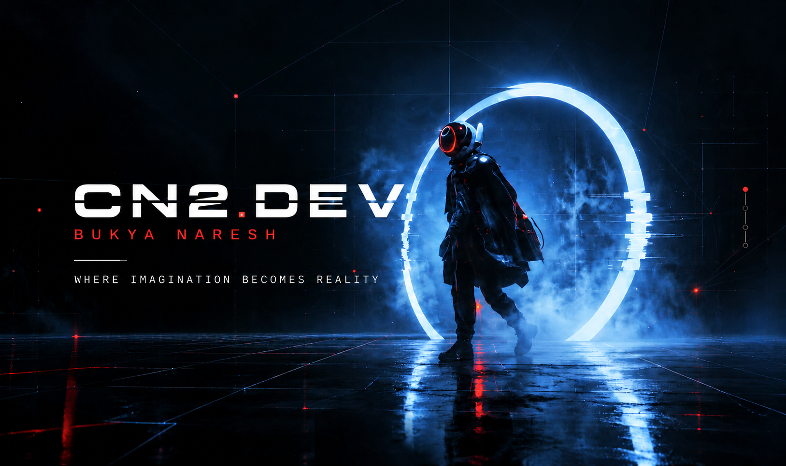

# CN2.DEV

**The digital headquarters of Bukya Naresh — Quantitative Developer**

[Live site](https://cn2-identity-hub.vercel.app) · [GitHub](https://github.com/naresh-cn2/cn2-identity-hub)

CN2.DEV is a multi-route professional platform covering quantitative development, systematic trading research, engineering services, and published technical writing. Every claim on the site is backed by real artifacts — working systems, test suites, research entries, certificates with verification links — and nothing is invented: no fabricated credentials, clients, metrics, or quotations.

---

## What lives here

| Destination | What it is |
| --- | --- |
| `/hub` | Headquarters — the master index of every destination |
| `/work` | WORK — the project catalogue; each project opens its own **world** (`/work/<project>`) with architecture, evidence, limitations and related research |
| `/case-studies` | Deep technical proof per project (`/case-studies/<project>`) |
| `/research` | Research entries with stated method, findings and limitations |
| `/articles` | Engineering articles |
| `/capabilities` | Capability map grounded in the archive |
| `/services` | Service offerings anchored to capabilities and proven by projects |
| `/lab` | Interactive tools — risk calculator, strategy viewer, market replay, experiments |
| `/intelligence` | Knowledge graph connecting projects, research and capabilities |
| `/credentials` | Issued certificates with issuer, IDs, dates and verification URLs |
| `/opportunities` | Career, freelance, collaboration and partnership pathways |
| `/testimonials` | Reviews & testimonials — consented feedback with per-review ratings |
| `/about`, `/identity`, `/cv`, `/proof`, `/links`, `/contact` | Profile, record and contact surfaces |

The four-level architecture: **Showcase → Project World → World Sections (architecture, evidence, limitations, research) → Knowledge Graph links**. Worlds are registered in `data/project-worlds.ts`; a world's navigation and sections are derived from the content that actually exists — empty sections are never padded.

---

## Tech stack

| Layer | Technology |
| --- | --- |
| Framework | [Next.js 16](https://nextjs.org) (App Router, static generation) |
| UI | React 19, TypeScript (strict), Tailwind CSS 4 (CSS-first config in `app/globals.css`) |
| Visual system | CSS, SVG and Canvas 2D — the site's core motion and atmosphere layer |
| Cinematic scenes | Three.js / react-three-fiber, limited to the home entry and the about figure; GSAP powers the home scroll choreography |
| Icons | lucide-react |
| Content | Typed data modules under `data/` — the single source of truth for pages, navigation and SEO |
| Reviews backend | Route handler + GitHub contents API (no database, no new services) |
| Accessibility | Semantic HTML, ARIA, visible focus states, `prefers-reduced-motion` support |
| Deployment | Vercel — every push to `main` deploys production |

---

## Getting started

**Requirements:** Node.js 20+ and npm (the repository ships a `package-lock.json`).

```bash
git clone https://github.com/naresh-cn2/cn2-identity-hub.git
cd cn2-identity-hub
npm install
npm run dev        # development server → http://localhost:3000
```

| Script | Purpose |
| --- | --- |
| `npm run dev` | Development server with hot reload |
| `npm run lint` | ESLint across the codebase |
| `npm run build` | Type-check + production build (all routes prerendered) |
| `npm start` | Serve the production build locally |

---

## Environment variables

The site runs with **no** environment variables. One optional integration exists — the testimonials publishing pipeline (see `.env.example`):

| Variable | Default | Purpose |
| --- | --- | --- |
| `REVIEWS_GH_TOKEN` | — | Fine-grained GitHub token (Contents: Read+Write on this repository). Enables automatic publishing of approved reviews. Without it, submissions are accepted into the owner's private server logs and publishing stays off. |
| `REVIEWS_REPO` | `naresh-cn2/cn2-identity-hub` | Repository used as the review store |
| `REVIEWS_PUBLISH_MODE` | `auto` | `auto` publishes validated, consented 4–5★ reviews immediately; `queue` commits them as pending until their status is flipped to `published` |

### How reviews are stored

Serverless filesystems are ephemeral and this project has no database, so the repository itself is the store: a validated submission with publication consent and a positive rating is committed to `data/testimonials.json` through the GitHub API, the existing GitHub → Vercel pipeline rebuilds, and the review appears on the site automatically. Lower ratings and reviews without publication consent are **never** committed — the repository is public, so that private feedback lives only in the owner's function logs. Public pages show per-review ratings only; no aggregate score is ever computed from a filtered set.

---

## Quality standards

- **Editorial honesty** — real evidence only; synthetic visuals are labeled `ILLUSTRATIVE`; testimonials appear only with the writer's consent and their own rating.
- **Responsive** — verified with rendered overflow sweeps from 320 px to 2560 px on every route; touch devices receive enlarged hit areas for compact controls while desktop sizing stays untouched.
- **Accessible** — keyboard-completable interactions (including the star-rating radiogroup), focus-visible states, reduced-motion freezes every animation at its neutral rest state.
- **Performance-conscious** — static generation for all content routes; canvases are DPR-capped, pause when the tab is hidden, and degrade deliberately on small screens.
- **SEO** — `app/sitemap.ts`, `app/robots.ts`, per-route metadata and canonical URLs.

### Automated QA

The rendered-output suites live in `scripts/qa/` and run against any build served on `:3000`:

| Suite | What it asserts |
| --- | --- |
| `api-check.ps1` | 7 reviews-API end-to-end checks (run first — deliberately ends on the per-IP 429 limiter) |
| `live-check.ps1` | 80 site-wide assertions — motion, accessibility, navigation, cinematic layers |
| `hub-check.ps1` | 56 hub-universe assertions |
| `world-check.ps1` | 69 project-world assertions |

```powershell
npm run build; npm start          # serve the production build on :3000
.\scripts\qa\api-check.ps1        # each suite accepts -Base http://host:port
```

GitHub Actions (`.github/workflows/ci.yml`) runs lint → type-check → production build → all four suites on every push to `main` and every pull request.

---

## Repository structure

```
app/                     App Router routes (see the route table above)
  api/testimonials/      Reviews intake — validation, rate limiting, publishing
components/
  work/  projects/        WORK catalogue, project worlds, architecture explorer
  case-study/  viz/      Evidence instruments, charts, schematics, canvas scenes
  hub/  testimonials/    Headquarters sections; review form, grid, endorsements
  layout/  ui/           Navbar, footer, ambience layer; reveal, atmosphere
data/                    Single source of truth — site, projects, worlds, reviews…
lib/                     Review submission validation (pure, framework-free)
public/                  Static assets (hero renders, identity photography)
app/globals.css          Design tokens, themes, motion system (Tailwind v4)
.env.example             Reviews publishing configuration
```

Adding a project world = one entry in `data/project-worlds.ts`; navigation and sections derive from the registered content automatically.

---

## License & contact

No license file is published — this is a personal project; all rights reserved.

**Bukya Naresh** — Quantitative Developer · [Live site](https://cn2-identity-hub.vercel.app) · [GitHub](https://github.com/naresh-cn2/cn2-identity-hub)
